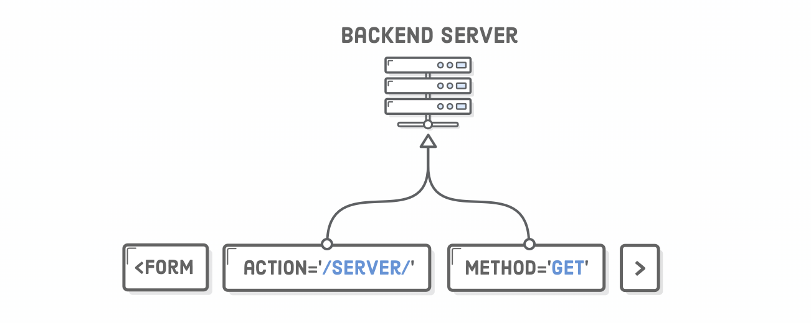

Using website: https://internetingishard.netlify.app/html-and-css/forms/index.html

- TITLE: HTML Forms: Number 13. of HTML & CSS Is Hard
- NOTE: Notice that we’re adhering to the mobile-first development approach that we discussed in the Responsive Design chapter. These base CSS rules give us our mobile layout and provide a foundation for the desktop layout, too. We’ll create the media query for a fixed-width desktop layout later in the chapter. 

